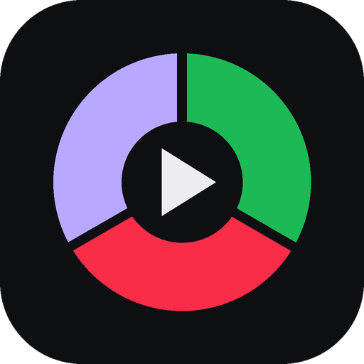

<div align="center">



# Unisono

**Spotify, Apple Music and YouTube Music. One app.**

Stop juggling three players. Unisono puts all your music services in a single window,
with one set of controls for all of them.

<br>

<a href="https://github.com/joaquinthegoat/unisono/releases/latest/download/Unisono-Setup.exe">
  
</a>

<sub><a href="https://github.com/joaquinthegoat/unisono/releases/latest">All downloads and release notes</a></sub>

</div>

<br>

## Why Unisono

|   |   |
| --- | --- |
| 🎧 **All three in one place** | Spotify, Apple Music and YouTube Music side by side. Switch with one click. |
| ⏯️ **One set of controls** | Play, pause and skip from the top bar, whichever service is playing. |
| ⌨️ **Media keys just work** | Your keyboard's play/pause and skip keys control whatever's playing. |
| 🔇 **One song at a time** | Start something in one service and the others pause automatically. |
| 🌙 **Keeps playing in the background** | Close the window and Unisono stays in the tray. |
| 🔄 **Always up to date** | New versions download by themselves. Just restart when asked. |

## Get started

1. **Download** the installer with the button above.
2. **Open it.** Unisono installs in seconds and starts on its own.
3. **Log in** to the services you use. You only do this once.

That's it. Find Unisono on your desktop or in the Start menu from now on.

> **Windows shows "Windows protected your PC"?**
> That's normal for independent apps. Click **More info → Run anyway**. You'll only see it once.

> **First launch takes a moment.** Unisono downloads the component Spotify and Apple Music
> need to play music. It only happens the first time.

## Everyday use

**Switch services:** click a tab, or press <kbd>Ctrl</kbd> + <kbd>1</kbd> / <kbd>2</kbd> / <kbd>3</kbd>.

**Control playback:** use the buttons at the top, your keyboard's media keys, the buttons that
appear when you hover over Unisono in the taskbar, or right-click the tray icon.

**Close vs. quit:** closing the window keeps the music going in the tray. To quit, right-click the
tray icon → **Quit**, or press <kbd>Ctrl</kbd> + <kbd>Q</kbd>.

| Shortcut | Does |
| --- | --- |
| <kbd>Ctrl</kbd> + <kbd>1</kbd> <kbd>2</kbd> <kbd>3</kbd> | Spotify · Apple Music · YouTube Music |
| <kbd>Ctrl</kbd> + <kbd>Tab</kbd> | Next service |
| <kbd>Alt</kbd> + <kbd>←</kbd> | Back |
| <kbd>Ctrl</kbd> + <kbd>R</kbd> | Reload the current service |
| <kbd>Alt</kbd> | Show the menu (settings, updates) |
| <kbd>Ctrl</kbd> + <kbd>Q</kbd> | Quit |

**Settings:** press <kbd>Alt</kbd> → **Unisono** to turn off "keep playing in the tray" or
"pause other services", or to check for updates.

## Good to know

- **You need your own accounts.** Unisono shows each service's official website, so your
  subscriptions, playlists and libraries are exactly as you left them.
- **Your logins stay on your PC.** Unisono doesn't collect any data. The only thing it contacts on its own is this page, to check for updates.
- **Uninstall** anytime from **Settings → Apps → Installed apps → Unisono**.

<details>
<summary><b>Something not working?</b></summary>

<br>

**Spotify or Apple Music won't play.** On the first launch, wait a minute, then press
<kbd>Ctrl</kbd> + <kbd>R</kbd>. If it still won't play, update to the latest version.

**Google says the browser "may not be secure" when signing in to YouTube Music.** Google sometimes
blocks sign-ins inside apps. Try again in a little while, or use the **Sign in** button on the
YouTube Music page itself.

**Media keys don't do anything.** Another app (like the Spotify desktop app or a game launcher) may
be using them. Close it and restart Unisono.

**Start completely fresh.** Uninstall Unisono, then delete the folder `%APPDATA%\Unisono`.

</details>

<details>
<summary><b>For the developer: publishing a new version</b></summary>

<br>

Everything happens on GitHub; no terminal needed.

1. **Actions** tab → **Release** (left) → **Run workflow**.
2. Type a version number higher than the last one (e.g. `0.1.1`) → **Run workflow**.
3. After about 10 minutes the new version is on the **Releases** page. The download button above
   always points to it, and installed copies update themselves.

**One-time setup**

- The repository must be **public**, or the download button and automatic updates won't work.
- Spotify and Apple Music use DRM, so each build is signed for free by castLabs EVS. Create an account
  once (`py -m pip install castlabs-evs`, then `py -m castlabs_evs.account signup`) and add it as two
  repository secrets under **Settings → Secrets and variables → Actions**: `EVS_ACCOUNT_NAME` and
  `EVS_PASSWD`.

**If a release fails:** open the failed run in **Actions** to see which step went red. Usual causes: the
version isn't in `1.2.3` form, that version was already released, or an EVS secret is misspelled.

</details>

<details>
<summary><b>For the developer: working on the code</b></summary>

<br>

Install [Node.js](https://nodejs.org) (LTS), [Git](https://git-scm.com) and Python once, then in the
project folder:

```powershell
npm install     # first time only
npm run dev     # run Unisono from the code (Ctrl+C in the terminal to stop)
npm run dist    # build an installer on your PC → dist\Unisono-Setup.exe
```

**How it's built**

Unisono is an [Electron](https://www.electronjs.org) app using
[castLabs Electron](https://github.com/castlabs/electron-releases), a version that can play
DRM-protected music. Each service runs in its own view inside one window; a small script inside each
one reports what's playing and receives play/pause/skip commands through the same media controls
Windows itself uses.

| File | Role |
| --- | --- |
| `src/main.js` | Window, tabs, tray, media keys, updates, "one song at a time" |
| `src/preload-service.js` | Reads what's playing in each service and controls it |
| `src/ui/` | The top bar |
| `build/vmp-sign.js` | Signs each build for DRM playback |
| `.github/workflows/release.yml` | Builds and publishes the installer |

</details>

<br>

<div align="center">
<sub>Unisono isn't affiliated with Spotify, Apple or Google. Each service's own terms apply.</sub>
</div>
